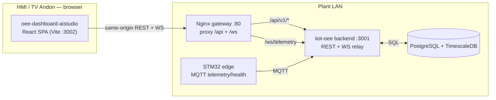
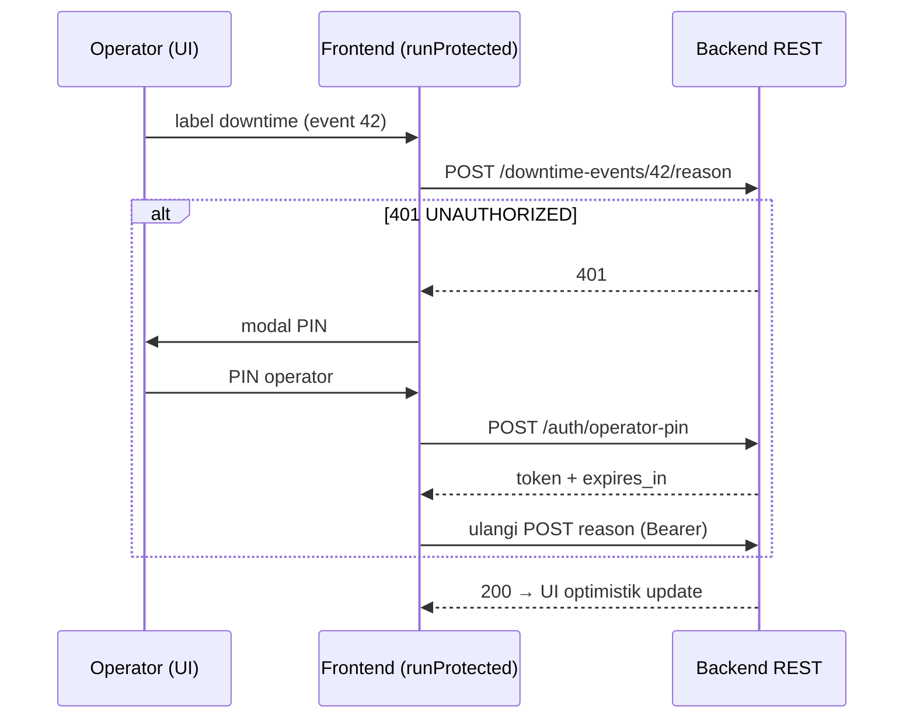

# Laporan Kekurangan Endpoint Backend (untuk Peningkatan `iiot-oee/apps/backend`)

> Tanggal: 23 Sep 2026 · Amandemen G12–G16: 24 Sep 2026 (verifikasi ulang pasca-refactor strict + hook split).
> Disusun dari audit migrasi total frontend `oee-dashboard-aistudio` ke lane backend.
> Acuan kontrak existing: `iiot-oee/apps/backend/docs/API_DOCUMENTATION.md`.
> Prinsip: setiap gap di bawah ini **sudah ada workaround jujur di frontend** (tampilkan kosong/`—`/0, bukan data fabrikasi). Daftar ini agar backend bisa menutupnya bertahap.
>
> **Cara pakai untuk tim backend (`iiot-oee`):** tiap item G12+ memuat blok "Yang harus dilakukan backend" (aksi konkret di sisi API) dan "Kriteria selesai" (cara verifikasi bersama dari sisi klien). Item G1–G11 memakai format lama (Usulan); kriteria G1 ditambahkan sebagai contoh, sisanya menyusul saat disentuh.

---

## Peta komponen & cakupan (audit 24 Sep 2026)

Hasil audit: **setiap fungsi frontend sudah punya pasangan backend atau gap tercatat** — tidak ditemukan kebutuhan backend baru yang belum tercatat. Garis putus-putus = belum ada di backend (lihat nomor G).

```mermaid
flowchart TB
    subgraph FE["Frontend adapters — src/infrastructure"]
        FElive["OeeHttpLiveStateRepository"]
        FEwo["OeeHttpWorkOrderRepository"]
        FEcmd["OeeHttpDeviceCommandGateway"]
        FEmaster["OeeHttpMasterDataRepository"]
        FEtele["OeeHttpTelemetryRepository"]
        FEauth["OeeHttpAuthGateway"]
        FEws["TelemetryWsClient"]
        FEsum["OeeHttpShiftSummaryRepository"]
        FEtls["OeeHttpShiftTimelineRepository"]
    end
    subgraph BE["Backend routes — iiot-oee"]
        RTlive["GET /live-state<br/>GET /live-state/:device"]
        RTwo["GET+POST /work-orders/*"]
        RTcmd["POST /devices/:id/command"]
        RTmaster["/devices /machines<br/>/products /operators<br/>bind + unbind"]
        RTtele["/telemetry/:id*<br/>/downtime-events/*<br/>/operational-events/:id"]
        RTauth["POST /auth/operator-pin"]
        RTws["WS /ws/telemetry"]
        RTsum["GET /oee/shift-summary"]
        RTtls["GET /oee/shift-timeline"]
        RTq["GET /quality/rejects/:device"]
        RTh["GET /devices/:id/health"]
        RTack["PATCH /operational-events/:id/ack"]
        RTfeed["GET /operational-events global"]
        RTref["POST /auth/refresh"]
    end
    FElive --> RTlive
    FEwo --> RTwo
    FEcmd --> RTcmd
    FEmaster --> RTmaster
    FEtele --> RTtele
    FEauth --> RTauth
    FEws --> RTws
    FEsum -.->|404 = fallback §2| RTsum
    FEtls -.->|404 = fallback §2| RTtls
    RTq -.->|G1| RTtele
    RTh -.->|G3| RTmaster
    RTack -.->|G4| RTtele
    RTfeed -.->|G5| RTtele
    RTref -.->|G13| RTauth
    classDef missing stroke-dasharray: 5 5;
    class FEsum,FEtls,RTsum,RTtls,RTq,RTh,RTack,RTfeed,RTref missing;
```





Alur mutasi ber-gate PIN (contoh: label downtime, lane backend):



### Matriks cakupan fungsi → backend

Audit 24 Sep 2026 — diverifikasi melawan pemanggil aktual di `src/` (bukan klaim dokumen lama).

**A. ✅ Cocok & dipakai — selesai dua sisi (atau fallback siap):**

| Fungsi frontend | Endpoint | Status |
|---|---|---|
| Boot fleet, snapshot per device | `GET /live-state`, `GET /live-state/:device` | ✅ Cocok (G16: tetap array telanjang) |
| WO list/resolve/dispatch/complete/cancel | `GET/POST /work-orders/*` | ✅ Cocok (G12: tabel 204-vs-body; detail lihat B1) |
| START/STOP/RESET/RESUME | `POST /devices/:id/command` | ✅ Cocok |
| Registry devices/machines, metadata, bind/unbind | `/devices`, `/machines`, `bind`, `unbind` | ✅ Cocok (produk/operator lihat B4) |
| Trend per jam + downtime + label + event/device | `/telemetry/:id/hourly`, `/downtime-events/*`, `/operational-events/:id` | ✅ Cocok (G14: konfirmasi flag labelable) |
| Login PIN + Bearer + replay 401 | `POST /auth/operator-pin` | ✅ Cocok (G13: refresh/TTL) |
| Tick realtime + lifecycle → alarm | `WS /ws/telemetry` | ✅ Cocok (G15: skema heartbeat) |
| Agregat shift Fase 2 | `GET /oee/shift-summary`, `GET /oee/shift-timeline` | ✅ Frontend siap + fallback 404 (backend belum ada — by design) |

**B. 🟡 Ada di backend, frontend belum pakai — belum selesai sisi frontend:**

| # | Endpoint (ada) | Kondisi kini | Tindakan frontend |
|---|---|---|---|
| B1 | `GET /work-orders/:id` | Adapter + `ListWorkOrdersUseCase.detail()` ada, **0 pemanggil UI** | Putuskan: pakai (mis. detail di ProductionSetupModal) atau hapus |
| B2 | `GET /telemetry/:id` (raw history) | ✅ Selesai 24 Sep 2026 — fallback overlay live bila aggregate gagal (`useLiveTrend` + `GetTelemetryHistoryUseCase`) |
| B3 | `GET /downtime-events/active` | ✅ Selesai 24 Sep 2026 — badge "N aktif" di `AlarmsZone` via `GetActiveDowntimesUseCase` (gagal → badge disembunyikan, boot error tetap via `loadError`) |
| B4 | `GET /products`, `GET /operators` | 🔶 Sebagian — QR backend mencocokkan WO via pending list (tanpa master); katalog statis tetap untuk lane simulasi. Opsi lanjut: ganti katalog QR simulasi dengan master backend |
| B5 | `GET /telemetry/:id/aggregate` | ✅ Selesai 24 Sep 2026 — overlay "Live 5m" di `EChartsOeeTrend` via `GetTelemetryAggregateUseCase` + `useLiveTrend` (windowed shift, limit 96) |
| B6 | `GET /telemetry/:id/export` | Tidak ada tombol export di UI (DoD §8 menuntut csv\|ndjson) | Tambah tombol Export audit atau coret dari DoD |
| B6 | `GET /telemetry/:id/export` | Tidak ada tombol export di UI (DoD §8 menuntut csv\|ndjson) | Tambah tombol Export audit atau coret dari DoD |
| B7 | `GET /health` | Tidak pernah dipanggil; footer rekonsiliasi (§2.2) belum ada | Sambungkan (ws_clients, buffer_pending) atau coret |

**C. 🔴 Belum ada di backend — butuh backend (tetap G1–G16):** reject breakdown (G1), health edge (G3), ack alarm (G4), feed global (G5), refresh token (G13), target/state/break per bucket (G2/G9/G10), konfirmasi flag labelable (G14), doc heartbeat (G15), tabel 204 (G12), FSM docs (G6), kebijakan reject manual (G7).

---

## G1 — Rincian reject / scrap per alasan (Prioritas: TINGGI)

- **Kebutuhan UI:** `LossAnalysisZone` → panel "Reject & Scrap Breakdown" (paralel dengan Downtime Pareto).
- **Kondisi kini:** tidak ada endpoint. Frontend menampilkan daftar kosong + `Total: <rejectCount> pcs` dari `live-state`.
- **Dampak:** analisis defect per shift tidak bisa diaudit; sebelumnya ditutup dengan fabrikasi 60/30/10 — sudah dihapus.
- **Usulan:**
  ```http
  GET /api/v1/quality/rejects/:device_id?from=&to=&limit=&cursor=&envelope=
  → { data: [{ reason: string, count: number, pct: number }], meta }
  ```
  Sumber: kolom `reject_count` delta per `wo_id`/per jam dari `oee_telemetry_logs`, atau tabel `quality_events` baru bila alasan perlu input operator (sejajar `POST /downtime-events/:id/reason`).
- **Kriteria selesai:** `LossAnalysisZone` menampilkan pareto alasan reject nyata (bukan daftar kosong); total persen = 100% dari `rejectCount` live-state pada window yang sama.
- **Alternatif tanpa skema baru:** `GET /telemetry/:id/aggregate` diperkaya `rejectDelta` per bucket — frontend agregasi per alasan tetap butuh kolom alasan.

## G2 — Target produksi per jam (Prioritas: SEDANG)

- **Kebutuhan UI:** `TrendZone` Hourly Production (`Target N pcs/hr`).
- **Kondisi kini:** `GET /telemetry/:id/hourly` tidak membawa target. Workaround frontend: `target_per_jam = target_qty(WO) / jam_shift`, dihitung di `BackendMachineRepository.buildOneSnapshot`.
- **Usulan:** sertakan `target_per_hour` pada respons `shift-summary` Fase 2 (sudah dispec di `specs/shift-overview-api.md §3.1`), atau field `hourly_target` di `work-orders/:id/resolve`.
- **Workaround kini:** cukup akurat; endpoint hanya untuk konsistensi antar layar.

## G3 — Status kesehatan edge controller (Prioritas: SEDANG)

- **Kebutuhan UI:** badge `Edge: OK/WARN`, panel `heap/tasks/stale`, tombol Edge I/O (disembunyikan di lane backend).
- **Kondisi kini:** health hanya via MQTT `oee/device/{id}/health` QoS0 tiap 5 dtk, tidak dipersist (FR-MQTT-006). Frontend backend menampilkan `0/0` → badge disembunyikan.
- **Usulan:**
  ```http
  GET /api/v1/devices/:deviceId/health
  → { timestamp, heap_free, tasks_healthy, tasks_total, stale_count, stale_tasks[], event_flags, age_sec }
  ```
  Implementasi ringan: cache payload health terakhir di memori/Redis saat relay MQTT masuk (tanpa migrasi DB), `age_sec` menandakan stale.
- **Workaround kini:** badge + tombol Edge I/O disembunyikan saat `useBackend=true`.

## G4 — Acknowledge / resolve alarm (Prioritas: RENDAH)

- **Kebutuhan UI:** `AlarmsZone` ack/resolve.
- **Kondisi kini:** tanpa endpoint; ack tersimpan lokal saja (`BackendAlarmRepository.updateAlarmStatus` memalsukan objek).
- **Usulan:** `PATCH /api/v1/operational-events/:id/ack {operator_id}` atau terima keputusan "alarm read-only, ack lokal saja" sebagai kontrak resmi.
- **Workaround kini:** lokal saja; antar sesi tidak sinkron.

## G5 — Umpan audit global lintas device (Prioritas: RENDAH)

- **Kebutuhan UI:** `AlarmsZone` agregat semua mesin tanpa N+1.
- **Kondisi kini:** `GET /operational-events/:deviceId` mewajibkan `deviceId` (path param). Frontend loop per device dari registry.
- **Usulan:**
  ```http
  GET /api/v1/operational-events?machine_id=&event_type=&from=&to=&limit=&cursor=&envelope=
  ```
  (query global, konsisten dengan pola cursor `{data,meta}` yang sudah ada).
- **Workaround kini:** fan-out per device di `BackendAlarmRepository.getAllAlarms` (50/event/device, cap 200).

## G6 — Penyelarasan nama state FSM (Prioritas: RENDAH, non-breaking)

- **Kondisi:** backend mengirim `PLANNED_DOWNTIME`/`UNPLANNED_DOWNTIME`; kontrak lama frontend memakai `PLANNED_DT`/`UNPLANNED_DT`.
- **Status:** sudah dinormalkan sisi klien (`live-state.dto.ts:normalizeState`). Tidak perlu perubahan backend; dicatat agar dokumentasi backend (§B/§4) dan skema `LiveStateResponseSchema` (`routes/live-state.ts`) menyebut himpunan FSM kanonis secara eksplisit.

## G7 — Pencatatan reject manual & pulsa counting (Prioritas: RENDAH — keputusan produk)

- **Kebutuhan UI lama:** tombol REJECT (+1), COUNT (+1), SPARE di `FloorPushButtonsPanel` (disembunyikan di lane backend).
- **Kondisi kini:** backend hanya kenal `finalRejectCount` saat `POST /work-orders/:id/complete`. Tidak ada endpoint "tambah 1 reject" / "pulsa counting" (benar: counting adalah domain edge/sensor, bukan REST).
- **Usulan:** nyatakan resmi bahwa lantai fisik/PLC adalah satu-satunya sumber counting; `LogEventModal` tab defect tetap disembunyikan di backend. Jika dibutuhkan, tambah `POST /work-orders/:id/reject {count, reason}` yang tervalidasi terhadap `totalCount`.
- **Workaround kini:** disembunyikan; reject hanya via complete WO.

## G8 — Pemicu UI untuk RESET_COUNTER di lane backend (Prioritas: SEDANG) — ✅ SELESAI SISI FRONTEND 24 Sep 2026

- **Kondisi:** `POST /devices/:id/command` mendukung `RESET_COUNTER` (SUPERVISOR/ADMIN, LAN), dan `BackendMachineRepository.resetCounters` sudah memanggilnya — tetapi satu-satunya pemicu UI (`FloorPushButtonsPanel`, `MqttEdgeInspectorModal`) disembunyikan di lane backend.
- **Implementasi:** aksi `resetCounters` di `useMachineActions` (via `runProtected` = RBAC PIN) + tombol RESET backend-only di `MachineStatusZone` dengan guard `window.confirm` + error lokal `role="alert"`.
- **Sisa:** tidak ada. Dicatat di sini agar tidak terlupakan.

## G9 — Status mesin per bucket pada hourly trends (Prioritas: SEDANG)

- **Kebutuhan UI:** `EChartsOeeTrend` menandai jam istirahat (arsir biru + tooltip `Istirahat`/`Running`) dan periode running pada grafik OEE Shift Trend.
- **Kondisi kini:** item `GET /telemetry/:id/hourly` hanya membawa angka OEE (`oee/availability/performance/quality`, `totalCount/goodCount/rejectCount`) tanpa status per bucket. Frontend memetakan `status` dari snapshot `live-state` saat itu juga — sama untuk semua bucket — dan menandai running sebagai komplemen jendela istirahat (`breakTimeWindow`). Periode down per jam yang sebenarnya tidak bisa ditandai.
- **Dampak:** arsir biru hanya menandai istirahat terjadwal; jam-jam breakdown/unplanned tetap terlihat "running" di grafik.
- **Usulan:** tambah status dominan per bucket pada respons hourly (aditif, non-breaking):
  ```json
  { "bucket": "2026-09-22T02:00:00+07:00", "oee": 63.8, "state": "RUNNING", "planned": false }
  { "bucket": "2026-09-22T02:00:00+07:00", "oee": 0.0, "state": "DOWN", "planned": false, "downtime_id": 42 }
  ```
  `state` = FSM dominan bucket (`RUNNING`/`DOWN`/…), `planned` = apakah bucket jatuh dalam planned stop (istirahat/maintenance terjadwal). Sumber: `oee_telemetry_logs.current_state` (downsample) + `downtime_events`.
- **Workaround kini:** running = komplemen jendela istirahat; akurat untuk planned, buta untuk unplanned per jam.

## G10 — Jendela istirahat terstruktur (Prioritas: SEDANG)

- **Kebutuhan UI:** `buildShiftTimeline` (`injectPlannedBreak`) menyisipkan segmen biru `Planned (Istirahat)` pada posisi jam sebenarnya di shift timeline; `EChartsOeeTrend` mengarsir jendela yang sama via `markArea`.
- **Kondisi kini:** backend hanya mengirim string bebas `break_window` (`"02:00 - 03:00"`) + `planned_break_min` via `work-orders/:id/resolve`. Frontend mem-parse string itu sisi klien (`parseBreakWindow`); bila string kosong/`—`/format lain, segmen/arsir istirahat tidak tampil (sengaja tidak difabrikasi posisinya).
- **Usulan:** kembalikan jendela istirahat terstruktur, mis. pada `resolve`/`shift-summary`:
  ```json
  "break": { "start": "02:00", "end": "03:00", "minutes": 60 }
  ```
  plus `window: { from, to, tz }` yang sudah dispec di `specs/shift-overview-api.md §3.1`. Frontend tetap fallback ke parse string selama field ini belum ada.
- **Workaround kini:** parse string klien; tanpa window valid, istirahat disembunyikan (bukan ditebak).

## G11 — Seri per-jam terlingkup shift (Prioritas: RENDAH)

- **Kebutuhan UI:** `EChartsOeeTrend` menampilkan grafik penuh mengikuti window shift (Mulai–Selesai), terurut menaik, tanpa sisa label lama saat data realtime bergerak.
- **Kondisi kini:** `GET /telemetry/:id/hourly` mendukung `from`/`to`/`limit`, tetapi frontend memanggil tanpa `from`/`to` (72 bucket terakhir) lalu mengurut + memfilter ke window shift sisi klien (`visibleTrends`, `setOption notMerge`). Berfungsi, tetapi memindahkan 72 bucket lintas hari setiap refresh 5 menit dan logika window terduplikasi di klien.
- **Usulan (salah satu):**
  1. Frontend teruskan window shift ke query existing (`hourly?from=:shiftStart&to=:now&limit=24`, pola §2.1 spec) — tanpa perubahan backend; atau
  2. `shift-summary` Fase 2 menyertakan `hourly[]` yang sudah terlingkup + terurut per shift (konsisten dengan `window` respons yang sama), sehingga grafik OEE cukup satu panggilan.
- **Workaround kini:** filter + sort klien; sudah benar, hanya boros dan duplikatif.

---

## Ringkasan prioritas

| ID | Endpoint/usulan | Prioritas | Status frontend sementara |
|---|---|---|---|
| G1 | `GET /quality/rejects/:device_id` | TINGGI | Daftar kosong + total reject nyata |
| G14 | Konfirmasi `active_only` + `unlabeled_only` di downtimes | TINGGI | Terkirim tanpa verifikasi dukungan |
| G2 | `target_per_hour` di shift-summary/resolve | SEDANG | Diturunkan klien dari WO |
| G3 | `GET /devices/:id/health` (cache) | SEDANG | Badge disembunyikan |
| G8 | Pemicu RESET_COUNTER di UI backend | SEDANG | Aksi tersedia di API, tanpa tombol |
| G9 | `state`+`planned` per bucket hourly | SEDANG | Running = komplemen istirahat |
| G10 | `break{start,end,minutes}` terstruktur | SEDANG | Parse string `break_window` |
| G12 | Kontrak 204-vs-body endpoint mutasi | SEDANG | Tipe klien berbohong untuk unbind |
| G13 | Refresh/revoke token operator | SEDANG | Reaktif-401 saja, tanpa refresh |
| G16 | Bentuk `GET /live-state` (array vs envelope) | SEDANG | Hanya array telanjang didukung |
| G11 | Seri per-jam terlingkup shift | RENDAH | Filter + sort klien |
| G4 | `PATCH /operational-events/:id/ack` | RENDAH | Ack lokal |
| G5 | `GET /operational-events` global | RENDAH | Fan-out per device |
| G6 | Dokumentasikan himpunan FSM | RENDAH | Dinormalkan klien |
| G7 | `POST /work-orders/:id/reject` (opsional) | RENDAH | Disembunyikan |
| G15 | Dokumentasikan heartbeat WS + idle timeout | RENDAH | Ping buta + reconnect backoff |

---

## G12 — Kontrak 204-vs-body endpoint mutasi (Prioritas: SEDANG, klarifikasi)

- **Kondisi:** `POST /machines/:machineId/unbind` diketik klien `Promise<MachineRecord>` (`IMasterDataRepository.unbindMachine`, dipakai `ConfigureDeviceUseCase`). Bila backend menjawab `204 No Content`, `httpClient` mengembalikan `undefined` dan tipe berbohong saat runtime.
- **Kondisi kini:** tidak meledak hari ini (hook membuang return lalu reload registry + fleet), tetapi rapuh bila return dipakai langsung di masa depan.
- **Usulan:** dokumentasikan per endpoint mutasi (`bind`/`unbind`/`dispatch`/`complete`/`cancel`/`downtime-reason`) mana yang mengembalikan body vs `204`. Bila `unbind → 204` resmi, klien akan mengubah signature ke `Promise<void>` + reload (tanpa reload ganda).
- **Yang harus dilakukan backend:** satu tabel di API docs: `endpoint | sukses → 200+body / 204 | skema body`. Meliputi minimal `machineBind`, `machineUnbind`, `workOrderDispatch`, `workOrderComplete`, `workOrderCancel`, `downtimeReason`.
- **Kriteria selesai:** tabel ada; `unbind` dengan device terikat me-return sesuai tabel (klien verifikasi via tab Network: body valid atau 204 murni, bukan 200-kosong).

## G13 — Refresh / revoke token operator (Prioritas: SEDANG)

- **Kondisi:** `POST /auth/operator-pin` mengembalikan `{token, expires_in}`; klien menyimpan token di `AuthTokenStorageAdapter` dan memakai `expiresIn` … tidak untuk apa-apa. Tidak ada endpoint refresh; kedaluwarsa hanya ditangani reaktif (modal PIN saat 401).
- **Dampak:** sesi mati di tengah shift panjang → aksi pertama pasca-kedaluwarsa selalu gagal sekali sebelum modal muncul.
- **Usulan (salah satu):** `POST /auth/refresh` (sliding session HMI) dengan adopsi klien pre-emptive, atau nyatakan TTL panjang + 401-reaktif sebagai kontrak resmi.
- **Yang harus dilakukan backend:** bila pilih refresh — `POST /api/v1/auth/refresh {token} → {token, expires_in}` (atau cookie httpOnly + endpoint); bila pilih TTL — cantumkan angka TTL di API docs (klien menampilkan countdown/himbauan login ulang bila < 15 menit).
- **Kriteria selesai:** salah satu terdokumentasi; skenario uji: login → tunggu lewat TTL → aksi dispatch → tidak ada kegagalan-buta pertama (refresh diam-diam renew, atau modal PIN muncul proaktif).

## G14 — Dukungan `active_only` + `unlabeled_only` di downtimes (Prioritas: TINGGI)

- **Kondisi:** `getLabelableDowntimes` memanggil `GET /downtime-events/:deviceId?limit=100&active_only=true&unlabeled_only=true`. Kedua flag **belum terverifikasi** didukung backend.
- **Dampak bila diabaikan backend:** daftar labelable berisi event yang sudah berlabel → `LogEventModal` menawarkan pelabelan ganda → `POST /downtime-events/:id/reason` ganda untuk event yang sama.
- **Usulan:** konfirmasi dukungan kedua flag (atau nama parameter kanonisnya bila berbeda); klien menyesuaikan `endpoints` + mapper bila perlu. Fallback klien (filter `operatorReason == null` sisi klien) dimungkinkan tetapi menutupi ketidaksepakatan kontrak — jangan dijadikan permanen.
- **Yang harus dilakukan backend (pilih satu, beri tahu klien):**
  1. Dukung `active_only=true&unlabeled_only=true` apa adanya; atau
  2. Beri nama kanonis (mis. `status=active&labeled=false`) + update contoh respons di API docs.
- **Kriteria selesai:** `GET /downtime-events/:device?limit=100&active_only=true&unlabeled_only=true` me-return hanya event aktif-belum-berlabel (klien verifikasi: tiap item `end_time == null` dan tanpa reason); `LogEventModal` backend tidak lagi menawarkan event yang sudah berlabel.

## G15 — Heartbeat WS + idle timeout (Prioritas: RENDAH, klarifikasi)

- **Kondisi pasca-refactor:** `TelemetryWsClient` mengirim teks `'ping'` tiap 25 dtk (mengharap teks `'pong'`) dan reconnect backoff (1s→30s) saat socket ditutup.
- **Acuan standar (Context7 `websockets/ws` README):** pola kanonis adalah *protocol-level* ping (opcode 0x09) dari server tiap 30 dtk + `terminate()` klien yang tidak menjawab; browser menjawab ping protokol **otomatis** tanpa melibatkan JS. Artinya ada dua skema yang mungkin di gateway, dan klien harus tahu yang mana:
  - (a) gateway menjawab teks `'ping'` aplikasi dengan teks `'pong'` → skema klien saat ini jalan;
  - (b) gateway memakai ping protokol `ws` → browser auto-pong, ping teks klien redundan tapi tidak merusak.
- **Risiko:** bila gateway menutup koneksi idle agresif (< 25 dtk), klien reconnect loop tanpa henti.
- **Yang harus dilakukan backend:** dokumentasikan di §4 API: (1) heartbeat level-aplikasi (`ping`/`pong` teks) atau level-protokol; (2) idle timeout server — harus > 30 dtk bila skema (a) dipertahankan, atau nyatakan skema (b) resmi agar klien bisa menghapus ping teks.
- **Kriteria selesai:** §4 API menyebut skema + timeout; klien diverifikasi 10 menit tanpa reconnect loop.

## G16 — Bentuk `GET /live-state` array-vs-envelope (Prioritas: SEDANG)

- **Kondisi:** `getAllSnapshots` hanya menerima array telanjang (`mapLiveStateListDto`: non-array → `[]`); semua endpoint list lain toleran `{data,meta}` via `unwrapList`.
- **Dampak:** bila backend suatu saat membungkus live-state dalam envelope, dashboard boot kosong **tanpa error** (filter `[]`).
- **Usulan:** tetapkan salah satu sebagai kontrak (disarankan: pertahankan array telanjang seperti kini), atau beri tahu agar klien menambah toleransi envelope (3 baris, tanpa risiko: hanya mengubah kasus yang kini rusak).
- **Status 24 Sep 2026:** toleransi envelope sisi klien **sudah diimplementasikan** (`mapLiveStateListDto` + test G16) — backend bebas memilih bentuk tanpa merusak klien.
- **Yang harus dilakukan backend:** satu baris di API docs § live-state: "`GET /live-state` selalu array telanjang" (lalu tidak ada kerja klien), atau beri tahu perubahan bila akan di-envelope-kan.
- **Kriteria selesai:** boot dashboard dengan 1+ mesin online menampilkan kartu mesin (bukan layar kosong tanpa error) untuk bentuk respons yang didokumentasikan.
