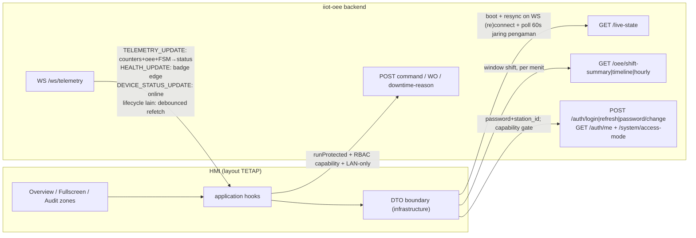

# Analisa Kebutuhan HMI vs API_DOCUMENTATION (Nov 2026) — Pembaruan Data Transfer

> Tanggal: 20 Nov 2026. Acuan: `iiot-oee/apps/backend/docs/API_DOCUMENTATION.md` (Fastify 5.x, spec 015/016/019/020/024/027/028/032/034/035/036/037/042/043/044).
> Audit sisi klien: seluruh `src/infrastructure/backend`, `src/infrastructure/realtime`, `src/application/hooks`, DTO boundary.
> **BATAS KERAS: tampilan/layout OEE live monitor repo ini TIDAK boleh berubah** (`OverviewPage`, `FullscreenOeeView`, `DashboardPage`, zona audit, panel, gauge). Semua perubahan hanya di lapisan data transfer: infrastructure adapters + DTO + application hooks. Satu-satunya perubahan presentasi yang tak terhindarkan: `AuthPinModal` (PIN numerik → password) karena kontrak backend menghapus PIN total — gaya visual modal dipertahankan.
>
> Kesimpulan: **YA, data transfer HMI perlu pembaruan.** Arsitektur hexagonal + dual-lane yang ada sudah benar dan dipertahankan; yang basi adalah kontrak auth, cakupan event WS, status WO, dan himpunan perintah. Detail di bawah.

---

## 1. Kondisi kini (yang sudah benar — jangan dirombak)

| Aspek | Implementasi kini | Vonis |
|---|---|---|
| Arsitektur | Hexagonal: ports → use-cases → hooks; DI `Container.ts`; dual-lane `VITE_USE_BACKEND` (simulasi vs backend) | Pertahankan |
| Boot load | `GET /live-state` (array telanjang, toleran envelope) + `GET /machines` join `machineId`; `machineName` hanya fallback display (§7C) | Cocok kontrak |
| Realtime | WS `/ws/telemetry`, route per `type` (`TELEMETRY_UPDATE`/`HEALTH_UPDATE`), unwrap `data`, drop `is_buffered`, ping teks 25s + backoff reconnect 1s→30s | Cocok §4/§7A (heartbeat dua lapis terkonfirmasi docs) |
| Agregat shift | `GET /oee/shift-summary` + `shift-timeline` sudah dikonsumsi, fallback 404 → komposisi klien | Cocok §Q (backend kini sudah implements) |
| Refresh proaktif | `runProtected` refresh diam-diam bila `exp` < 120s (G13) | Cocok §6D, perlu penyempurnaan (lihat P2-1) |
| Health footer | `GET /health` poll 30s | Cocok §A |
| DTO toleransi | camelCase/snake_case, `avg*` legacy, `recordedAt`, envelope `{data,meta}` | Sebagian basi (lihat P2-3) |

## 2. Temuan — kebutuhan pembaruan (prioritas)

### P0 — RUSAK terhadap backend sekarang (blocking)

**P0-1. Login PIN sudah dihapus backend → 404.**
- Klien: `endpoints.authOperatorPin()` = `/api/v1/auth/operator-pin` (`endpoints.ts:39`), `OeeHttpAuthGateway.loginWithPin` (`oeeApiClient.ts:326`), `AuthPinModal` input numerik 8 digit.
- Kontrak (§L): "Legacy `POST /auth/operator-pin` DIHAPUS total → 404. Klien PIN lama wajib pindah ke `/login`." Kredensial = `operator_id` + password (min 8, PBKDF2). PIN dihapus total (020/ADR-0012).
- Aksi: ganti ke `POST /api/v1/auth/login {operator_id, password, station_id?}`. `AuthPinModal` → form password (type=password, tanpa filter numerik), gaya visual tetap. Respons `{success, token, expires_in, operator{id, username, role, line_id, must_change_password}}`.
- **`station_id` bukan input manual** (spec 044): klien menurunkan dari konteks kiosk (explicit → query → store → registry → env), harus `deviceId` terdaftar di `devices`; nilai tak terdaftar → `400 STATION_NOT_FOUND`. Bug kini: `useOeeDashboard.ts:230` `getStationId: () => machines.currentDeviceId || machines.currentMachineId` — fallback `currentMachineId` (mis. `CNC-MILLING-01`) bukan deviceId → akan 400. Perbaiki: hanya deviceId tervalidasi dari registry; kosong bila tak ada (throttle `<ip>:default`).
- Rate limit login `5/60s` per `<ip>:<station_id>`; `429 + Retry-After` → tampilkan countdown, JANGAN lockout paralel di klien (docs eksplisit: backend satu-satunya sumber throttle).

**P0-2. Gerbang ganti-password-wajib (spec 043) tidak ditangani.**
- Selama `must_change_password=true`, semua rute terproteksi kecuali `GET /auth/me` + `POST /auth/password/change` → `403 PASSWORD_ROTATION_REQUIRED`. Klien kini: 403 bukan 401 → lolos dari `isUnauthorizedError` → error buta.
- Aksi: (1) simpan flag dari respons login; (2) bila true → paksa dialog ganti password (`{current_password, new_password}` kanonis, tanpa alias `old_password`); (3) sukses ganti → `authz_version` naik → token lama `401 AUTHZ_STALE` → **wajib login ulang otomatis** (jangan reuse token).

**P0-3. Status WO `PENDING_CLOSE` tidak dikenal klien.**
- Klien: `WorkOrderStatus = 'PENDING'|'ACTIVE'|'COMPLETED'|'ABORTED'` (`WorkOrder.ts:4`); grep `PENDING_CLOSE` di `src/` = 0 hit.
- Kontrak (§C, ADR-0021): telemetri `BATCH_FINISHED` → WO otomatis `PENDING_CLOSE`; `complete` menerima `ACTIVE|PENDING_CLOSE`; konfirmasi operator tetap wajib menulis `actual_end_at` + snapshot final.
- Aksi: tambah `PENDING_CLOSE` ke union + `isActiveWorkOrder`; UI existing (tombol complete di flow WO) dipakai untuk konfirmasi — tanpa layout baru. Guard klien: `finalRejectCount ≤ totalCount` (backend `400 SCRAP_COUNT_INVALID`); `409 UNCLASSIFIED_DOWNTIME_CONFLICT` → arahkan operator melabeli downtime dulu (flow label sudah ada). Field workflow baru (`dispatched_at`, `acked_at`, `actual_start_at`, `actual_end_at`, `provisional`, `count_uncertain`) boleh dipetakan aditif; `start_time` kini = telemetri RUNNING pertama, bukan ACK.

### P1 — Data live tidak lengkap / basi tanpa reload

**P1-1. Merge WS tidak memperbarui status FSM mesin.**
- `useTelemetrySubscription.ts:34-69` hanya merge counters/time/oee/health; `frame.fsmState` dibuang. `machine.status` hanya berubah saat boot/reload (`BackendMachineRepository.mapLiveStateToMachineStatus`). Transisi RUNNING → UNPLANNED_DOWNTIME tidak tampil live di layout yang ada.
- Aksi: merge `status` dari `fsmState` (normalisasi kanonis 6 nilai §6A/§7D; `STANDBY` sudah dinormalisasi server → READY) + `statusSince` saat transisi. Tanpa perubahan komponen.

**P1-2. Hanya 5 dari 26 tipe envelope WS dipetakan.**
- `mapWsLifecycleEventDto` (`telemetry.dto.ts:321`) menangani `MACHINE_BOUND/UNBOUND/DELETED`, `PRODUCT_DELETED`, `WORK_ORDER_CANCELLED`. Sisanya dibuang (aman, ignore-unknown by design) tetapi state jadi basi:
  - `DEVICE_STATUS_UPDATE` → badge online/offline (`connectionStatus`) tidak pernah update live; `isOnline` boot = proyeksi TTL 300s (§7E).
  - `DOWNTIME_EVENT_OPENED/CLOSED/REASON_LABELED` → daftar labelable + count aktif hanya refresh saat ganti mesin.
  - `WORK_ORDER_COMPLETED` → jobConfig/WO selesai tidak tercermin sampai reload.
  - `MACHINE_CREATED/UPDATED`, `PRODUCT_CREATED/UPDATED`, `PRODUCTION_LINE_*`, `SHIFT_*`, `SHIFT_SCHEDULE_*`, `DEVICE_EVENT` → registry/katalog basi.
- Aksi: perluas union `WsLifecycleEvent` + mapper; strategi merge: event master/WO → **debounced refetch REST** (registry/fleet/labelable, ~1-2s) bukan fabrikasi state dari payload tipis; `DEVICE_STATUS_UPDATE` → update langsung `connectionStatus`. Perhatikan casing campuran (WO snake_case + `topic`, downtime camelCase) — docs §4 mewajibkan defensif.

**P1-3. Tidak ada resync snapshot setelah reconnect WS.**
- `TelemetryWsClient.onopen` hanya reset counter backoff. Frame terlewat selama putus tidak dikejar; counter/OEE bisa timpang dari `device_live_state`.
- Aksi: setiap `onopen` (termasuk reconnect) → panggil `GET /live-state` sekali untuk rekonsiliasi fleet (endpoint dirancang untuk initial load < 2ms). Tambah indikator staleness dari `lastTelemetryAt`/`updatedAt` (data layer; komponen badge yang ada memakai nilai itu). Poll periodik frekuensi rendah (mis. 60s) opsional sebagai jaring pengaman WS mati total — bukan pengganti WS.

**P1-4. Close code WS 4403/4429 tidak dibaca.**
- `onclose` (`telemetryWsClient.ts:80`) reconnect buta semua close. Kontrak §4: `4403` Forbidden Origin (konfigurasi `CORS_ORIGIN` salah — reconnect percuma), `4429` rate limit 120 koneksi/menit/IP (backoff harus lebih panjang + jitter).
- Aksi: baca `event.code`; 4403 → berhenti + error eksplisit ke UI (banner error yang ada); 4429 → backoff mulai ≥ 60s; selain itu → backoff kini + resync P1-3.

**P1-5. Himpuan perintah kurang 3 + body `count` tidak dikirim.**
- Klien: `DeviceCommandKind = 'PAUSE'|'RESUME'|'RESET_COUNTER'` (`Device.ts:44`); `sendCommand` body tanpa `count` (`oeeApiClient.ts:121`).
- Kontrak §D: enum 6 — tambah `PLANNED_DT_START`/`PLANNED_DT_END` (fallback manual istirahat, OPERATOR+) dan `COUNT_ADJUST` (koreksi hitungan pasca edge offline/K8, wajib `count` 0..999999, OPERATOR+). `RESET_COUNTER` tetap SUPERVISOR/ADMIN.
- Aksi: perluas union + `count?: number` di `DeviceCommandInput`, kirim bila `COUNT_ADJUST`; validasi reason ≥ 5 char sudah ada. Pemicu UI memakai tombol/panel yang sudah ada (mis. `KontrolTab`/`MachineStatusZone`) — tanpa layout baru; gate RBAC per capability (P2-2). Semua perintah LAN-only + audit fail-closed: `403` dari tunnel harus tampil sebagai "read-only", bukan error generik.

### P2 — Kontrak data & otorisasi (benar secara fungsi, salah secara kontrak)

**P2-1. Refresh token menelan semua error.**
- `refreshSession` catch-all → null (`oeeApiClient.ts:372`). `401 AUTHZ_STALE` (role dicabut/ password diganti) dan subjek nonaktif harus memaksa logout + login ulang, bukan loop modal. Tambah refresh berkala ringan (mis. tiap 5 menit selama sesi aktif) agar HMI idle panjang tidak selalu bergantung aksi pertama; TTL 900s sliding (§6D). Refresh hanya LAN — di tunnel jangan coba.

**P2-2. Capability `/auth/me` + `/system/access-mode` tidak dipakai.**
- UI kini gate aksi hanya lewat ada/tidaknya token (`runProtected`), bukan RBAC. Kontrak §L/§3.4: `GET /auth/me` → `authz.capabilities[]` (`allow/deny/unknown` per `<domain>.<action>`) untuk menampilkan UI sesuai hak; `GET /system/access-mode` → `{mode, channel, mutations_allowed}` untuk read-only vs read-write (HMI via tunnel = observasi saja).
- Aksi: fetch `/auth/me` pasca login + saat refresh; simpan capability map di application layer; disable tombol aksi yang `deny` (RESET_COUNTER untuk OPERATOR, dll). `mutations_allowed=false` → semua mutasi disembunyikan/dinonaktifkan + penanda read-only memakai elemen yang ada. `operators.role`/`primaryRole` = **string bebas** — union `OperatorRole` (`Device.ts:33`) basi; tampilkan apa adanya.

**P2-3. Skema kanonis hourly/aggregate `*Pct` belum dibaca; null dipaksa 0.**
- Kontrak §7J/§6D1: kanonis `availabilityPct/performancePct/qualityPct/oeePct` (string-numeric **nullable**) + `totalCount/goodCount/rejectCount` + `operatingSec/runSec` + `sampleCount` + `provisional`; `hourlyDowntimeSec` dihapus; tidak ada nama legacy ganda di dokumen. DTO kini hanya baca `avg*`/`oee` legacy (`telemetry.dto.ts:203-227`) → bila backend kirim kanonis murni, semua bucket ter-map 0.
- `toFiniteNumber(null)` → 0 (`LiveState.ts:33`): padahal `null` = "bucket belum punya sampel ber-`udt`/penyebut nol", bukan 0 (016/ADR-019). Pertahankan `null` di domain (tampil `—`), jangan fabrikasi 0.
- Aksi: DTO terima `*Pct` (menang) + alias `avg*` selama transisi; petakan `provisional` (bucket belum final — tandai di tooltip yang ada); `operatingSec/runSec` per bucket tersedia untuk time accounting.
- Semantik availability berubah: `run/(run+unplanned)` — planned downtime TIDAK lagi menurunkan Availability. `shift-summary` server sudah benar; fallback komposisi klien (`CalculateOeeUseCase`, lane simulasi) perlu diselaraskan agar tidak divergen saat server summary absen. Live-state = kumulatif lifetime, agregat = SUM delta per bucket — hanya sebanding pada jam produksi aktif (§7B D1); jangan "koreksi" selisihnya.

**P2-4. Ack operasional-event kirim field deprecated.**
- `acknowledgeOperationalEvent` body `{operator_id, note}` (`oeeApiClient.ts:273`). Kontrak §I: aktor dari subjek JWT; `operatorId`/`operator_id` deprecated dan diabaikan. Body cukup `{note?}`. Idempoten — ack kedua mengembalikan nilai lama. Respons sintetis `eventType:'ACKNOWLEDGED'` boleh tetap (bukan kontrak wire).

**P2-5. `station_id`/konteks kiosk (lanjutan P0-1).**
- Spec 044: sesi HMI dengan konteks tervalidasi memuat klaim `device_id` (sign-only). Simpan station context (localStorage adapter yang ada) agar login berikutnya konsisten; urutan resolusi explicit → query → store → registry → env.

### P3 — Opsional (bukan blocking; jangan bangun sebelum dibutuhkan)

| Endpoint | Nilai untuk HMI | Rekomendasi |
|---|---|---|
| `GET /machines/:id/status-history` (027) | Riwayat interval status per mesin (audit) | Tambah hanya bila halaman audit butuh; di luar live monitor |
| `GET /telemetry/rollup` | OEE multi-mesin/harian/bulanan | Untuk overview plant masa depan; YAGNI sekarang |
| `POST /telemetry/reconciliation/refresh` | Segarkan CAgg pasca backlog edge (72h store-and-forward) | Tombol supervisor opsional; relay sudah drop `is_buffered`, CAgg refresh policy 5 menit |
| Export downtime/audit/hourly | CSV/NDJSON offline | `exportTelemetry` sudah ada; sisanya bila diminta |
| `/devices/provision`, `/revoke`, `/credentials` | Provisioning fleet | Domain Admin Panel, bukan HMI operasional — jangan masuk repo ini |
| `/production-lines`, `/shifts`, `/shift-schedules` | Master shift/lini (ADMIN LAN) | Selektor shift HMI kini string bebas; konsumsi hanya bila produk meminta dropdown shift nyata |
| `/health/detail`, `/mqtt/*`, `/access-control/*` | Admin infra | Di luar cakupan HMI |

## 3. Bagaimana sebaiknya HMI dibuat (target data transfer)

Arsitektur tetap: **REST untuk state awal + rekonsiliasi, WS untuk hot-path, DTO boundary sebagai satu-satunya penerjemah kontrak.** Layout live monitor dibekukan.

Aturan main:
1. **WS = sumber kebenaran live**; jangan polling agresif. Resync `GET /live-state` hanya saat (re)connect + jaring pengaman frekuensi rendah.
2. **Event lifecycle tipis → refetch, bukan fabrikasi.** Payload WS lifecycle tidak membawa state lengkap; debounce 1-2s lalu baca REST terkait.
3. **Null ≠ 0.** Semua field nullable kontrak (`*Pct`, `provisional`, health cache-miss) dipertahankan null sampai presentation yang sudah ada menampilkannya sebagai `—`/disembunyikan.
4. **Auth = password + station context + capability.** Tidak ada PIN, tidak ada lockout klien, tidak ada tebakan role dari enum; `deny`/tunnel → UI read-only.
5. **Semua mutasi lewat `runProtected`** (sudah ada) + gate capability + alasan ≥ 5 char; error kontrak (`PASSWORD_ROTATION_REQUIRED`, `AUTHZ_STALE`, `DEVICE_OFFLINE`, `UNCLASSIFIED_DOWNTIME_CONFLICT`, `SCRAP_COUNT_INVALID`, 429 `Retry-After`) ditangani eksplisit, bukan pesan generik.
6. **Dual-lane tetap**: `VITE_USE_BACKEND=false` untuk dev tanpa stack; perubahan kontrak hanya di lane backend + DTO bersama.

## 4. Urutan eksekusi (usulan)

| Fase | Isi | Kriteria selesai |
|---|---|---|
| 1 (P0) | `/auth/login` + password modal + station_id benar + gerbang `must_change_password` + `PENDING_CLOSE` | Login lawan backend hidup sukses; aksi terproteksi jalan; WO batch-finished bisa dikonfirmasi; tanpa perubahan layout live monitor |
| 2 (P1) | FSM merge WS + lifecycle lengkap + resync reconnect + close 4403/4429 + 6 perintah + `count` | Transisi status tampil < 1s tanpa reload; badge online ikut `DEVICE_STATUS_UPDATE`; putus WS → resync benar; COUNT_ADJUST terkirim dengan count |
| 3 (P2) | DTO `*Pct` kanonis + null-preserving + `provisional`; `/auth/me` capability gate; `access-mode` read-only; refresh `AUTHZ_STALE`; ack tanpa `operator_id`; formula availability fallback selaras | Grafik tidak nol saat backend kanonis; tombol sesuai hak; tunnel = read-only; sesi stale → login ulang bersih |
| 4 (P3) | Hanya bila produk meminta | — |

Tiap fase: test vitest DTO/hook (pola test existing), verifikasi E2E lawan stack `iiot-oee` hidup (docker), dan update `docs/specs/backend-gaps.md` bila ada kontrak yang ternyata masih beda dari dokumen.

## 5. Catatan dokumen lama

- `docs/specs/backend-gaps.md` (G1–G22, Sep 2026) sebagian sudah ditutup backend: G1/G3/G4/G5/G13/G17/G18/G19/G20/G21/G22 kini terdokumentasi resmi di API docs Nov 2026 (§Q, §R, §I, §6, §7). G19 `isOnline` kini proyeksi TTL 300s (§7E). **G13 berubah bentuk**: PIN dihapus total — item lama "login PIN ✅ cocok" kini RUSAK (P0-1 di sini).
- `docs/specs/shift-overview-api.md` Fase 1 sudah diimplementasikan backend (§Q) — fallback 404 klien tetap aman.
- Dokumen ini menggantikan asumsi auth/WS/WO lama untuk pekerjaan data transfer berikutnya.
